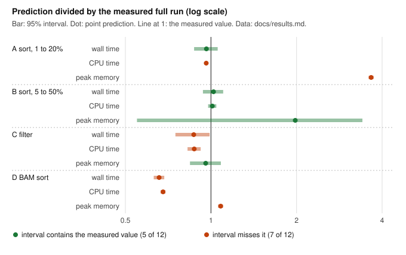

# pipeprof

`pipeprof` measures how much memory, CPU and time a bioinformatics job needs, before,
during and after it runs on a Slurm cluster, and turns the measurements into
resource requests for Slurm, Nextflow and Snakemake.

## The problem

A cluster job has to say in advance how much memory and time it needs. Ask for
too little and the scheduler kills the job (out of memory or time limit), often
hours in. Ask for too much and the job waits longer in the queue, blocks other
users, and burns allocation that the lab pays for. Most requests are guesses
copied from an older script.

`pipeprof` replaces the guess with a measurement:

1. Before submission, `pipeprof calibrate` runs the command on 1, 2, 5, 10 and 20
   percent subsamples of the real input, fits how time and memory grow with
   input size, and predicts the full run with an uncertainty range.
2. During the run, `pipeprof watch` samples the job and warns when memory nears
   the limit, CPUs sit idle, or the job stops making progress.
3. After the run, `pipeprof report` reads Slurm accounting (`sacct`), Nextflow
   trace files and Snakemake benchmark files, shows what was used against what
   was requested, and recommends the next request.



Four calibrations on ClinVar (200 MB VCF) and a 1000 Genomes BAM, each
checked against a full run the fit never saw. Time predictions landed
between 0.66 and 1.02 of the measured value. The 95% interval held the
measured value in 5 of 12 cases: it covers scatter around the fitted curve,
not a curve of the wrong shape. Run A overestimated `bcftools sort` memory
3.7 times because the tool stops growing at its `-m 512M` buffer, which the
1 to 20 percent subsamples never reached; run B, with larger subsamples,
cut that to 2.0 times and its interval held the measured value. No emitted
request was too small for its full run. Commands and the full table are in
[docs/results.md](docs/results.md); `scripts/plot_validation.py` redraws the
figure from that table.

A plain-language explanation of why this saves cluster time is in
[docs/why_profiling.md](docs/why_profiling.md).

## Quick start

Needs Python 3.11 or newer.

```bash
git clone https://github.com/Daneshpajouh/pipeprof
cd pipeprof
python3 -m venv .venv && . .venv/bin/activate
pip install -e .

# 1. After (seconds): a report from the sacct test data in the repository
pipeprof report --sacct tests/data/sacct_slurm_26_05.txt --outdir report

# 2. Before (under a minute, no download): calibrate `sort` on 2 million numbers
python3 -c "import random; r = random.Random(1); print('\n'.join(str(r.random()) for _ in range(2_000_000)))" > numbers.txt
pipeprof calibrate numbers.txt --outdir cal --job-name sort_numbers --validate-full -- \
    sort -o '{output}' '{input}'
cat cal/sbatch_header.sh

# 3. During: watch a command and view the log
pipeprof watch --out watch.jsonl --interval 1 --mem-limit 512M -- sort -o sorted.txt numbers.txt
pipeprof tail watch.jsonl --once
```

Step 2 on an Apple M3 Ultra (macOS 27.0.1, Apple sort 2.3), 2026-10-19:

```
metric          model   predicted   95% interval
wall_s          linear  1.93 s      1.65 s to 2.22 s
cpu_s           linear  2.50 s      2.09 s to 2.92 s
peak_rss_bytes  linear  348.3M      309.6M to 387.0M
Request: --cpus-per-task=1 --mem=512M --time=00:05:00
full run wall_s: predicted 1.933, actual 2.183, inside interval: True
full run cpu_s: predicted 2.501, actual 4.221, inside interval: False
full run peak_rss_bytes: predicted 3.652e+08, actual 4.952e+08, inside interval: False
```

Wall time was 13 percent above the prediction, inside the interval. Memory
was 36 percent higher than predicted (472 MiB) and the 512M request covered it
with 8 percent to spare. CPU time was 69 percent higher: Apple's sort used 1.9
cores on the full input but at most 1.3 on the subsamples, and `pipeprof`
logged a warning that the command used more cores than `--threads`. The
subsample runs lasted 0.03 to 0.39 s, too short for a reliable fit; the
ClinVar runs in the figure above, with subsamples of 2 to 100 MB, are the
better guide.

On Alliance clusters, install the dependencies from the cluster wheelhouse
with psutil below 7.2, then the `pipeprof` wheel:
[docs/clusters.md](docs/clusters.md).

## What it reads and writes

| Command | Reads | Writes |
|---|---|---|
| `pipeprof calibrate INPUT -- CMD` | VCF (`.vcf`, `.vcf.gz`), BAM or CRAM (via samtools), FASTQ, line based text | `calibration.json`, `sbatch_header.sh`, `snakemake_resources.smk`, `snakemake_slurm_profile.yaml`, `nextflow_resources.config`, `nextflow_directives.nf`, `pipeprof.log.jsonl` |
| `pipeprof watch` | a local PID, a command to start, or a Slurm job ID (`sstat`) | JSON lines: samples and alerts |
| `pipeprof tail` | a watch log | live terminal view |
| `pipeprof report` | `sacct --parsable2` output (Slurm 20.11 and 21.08+ formats), Nextflow trace files (default and raw), Snakemake benchmark files and run log | `report.md`, `report.html`, `report.json` |
| `pipeprof analyze` | a Nextflow trace, Snakemake benchmark files and run log, or a plain name/start/end TSV | `analysis.md`, `analysis.json`: critical path, step shares, parallel efficiency, boundness, recommendations |
| `pipeprof provenance` | files to hash | JSON: host, tool versions, git commit, SHA-256 |

The logging library is importable on its own:

```python
from pipeprof.logkit import RunLogger

log = RunLogger("variant_qc", jsonl_path="logs/variant_qc.jsonl")
with log.step("bcftools_norm", sample="NA12878") as fields:
    fields["records_out"] = 412_093
log.close()
```

## Documentation

- [Why profiling saves cluster time](docs/why_profiling.md), for non-specialists
- [User guide](docs/user_guide.md)
- [Scaling fit and its validation](docs/algorithm.md)
- [Results from real runs](docs/results.md)
- [Testing strategy](docs/testing.md)
- [Input formats and their sources](docs/formats.md)
- [Postmortems](docs/operations/): Snakemake on macOS, ClinVar subsamples without contig lines
- [Data sources](docs/data_sources.md), [roadmap](ROADMAP.md), [changelog](CHANGELOG.md)

## Development

```bash
make dev      # venv with test and lint tools
make check    # ruff, ruff format --check, mypy --strict, pytest with coverage
make build    # sdist and wheel, then twine check
```

Licence: Apache-2.0. Author: Amir Daneshpajouh.
